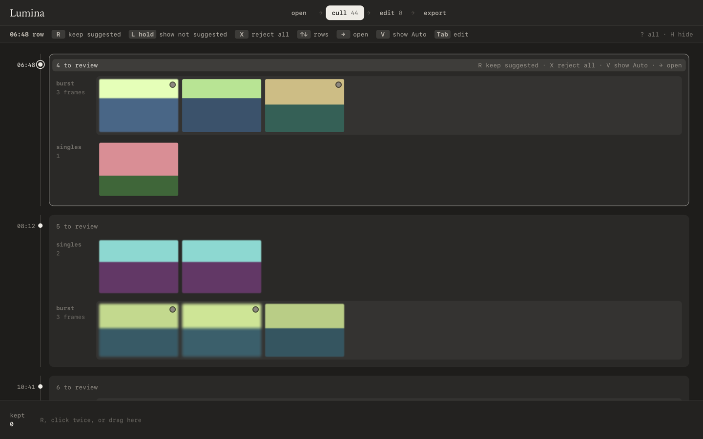

# Lumina

A Mac app for sorting a Sony shoot, stills and video. Open a card or a folder, go through it with the
keyboard, and hand what you keep to Lightroom Classic, Capture One or Final Cut Pro. Your originals
are never changed.



## Stills

```
Open ──▶ Pick ──▶ Edit (optional) ──▶ Save
```

| Step | What you do | What Lumina can do here | What it writes |
|---|---|---|---|
| **Open** ⌘1 | Choose a folder (⌘O) or a Sony card | Reads the RAWs where they are, no import. Reopens a shoot where you left it | Nothing |
| **Pick** ⌘2 | Keep the photos you want | Rows by time, similar frames stacked, the frame with the most detail marked in gold. Flags **soft**, **blown** and **shake**. Large view, 100 %, focus edges in red. Passes: go round again with only what you kept | Nothing; your choices are saved in the app |
| **Edit** ⌘3 | Adjust the photos you kept | Exposure, white balance, contrast, highlights, shadows, whites, blacks, clarity, vibrance, saturation, black and white, sharpening, noise reduction, vignette, crop and straighten. Copy and paste a look across photos | Nothing to your files |
| **Save** ⌘4 | Hand off | A rated `.xmp` sidecar beside each RAW you kept (⌘⏎). Optionally JPEGs with your edits, at 2048 px or full size | `.xmp` files, and JPEGs if you ask |

Keys in Pick: **⏎** keeps a photo and moves on, **R** un-keeps it and moves on, the arrows pass.
Hold ⇧ to do the same going back, or to work inside a stack. **Space** shows a photo large, hold
**Z** for 100 %, hold **F** for focus edges. **Q** or ⌘Z undoes. **?** lists every key.

## Video (Skim, in development)

```
Open ──▶ Skim ──▶ Export
```

| Step | What you do | What Skim can do here | What it writes |
|---|---|---|---|
| **Open** | Choose a folder of clips (MP4, MOV, MXF) | Reads a Sony `M01.XML` sidecar when one is next to a clip: frame rate, recording time, colour profile | Nothing |
| **Skim** | Mark each clip **keep** (K), **maybe** (M) or **cut** (C or X) | Three levels: chapters (split at long gaps), takes, and one clip. Eight frames per clip and a Viewer to play it. Measures exposure, clipped and crushed areas, sharpness and camera motion. A Rec.709 preview for S-Log3 clips | Nothing |
| **Export** | Send the keepers to Final Cut Pro | An `.fcpxml` with your marks as ratings. In the app: the drive's free space, and moving cut clips to the Trash | An `.fcpxml`; the Trash only when you ask |

### Trying it on the T7 clips

Seven a7S III clips sit at the root of the T7 drive:

| Clips | Format | Rate | Length |
|---|---|---|---|
| C0054 | XAVC S-I, H.264 4:2:2 10-bit | 23.98p | 27 s, 0.8 GB |
| C0079, C0094, C0095, C0100 | XAVC S-I, H.264 4:2:2 10-bit | 29.97p | 62 to 65 s, 2.2 to 2.3 GB |
| C0099 | XAVC S-I, H.264 4:2:2 10-bit | 59.94p | 54 s, 3.9 GB |
| C0070 | XAVC S, H.264 4:2:0 8-bit | 59.94p | 78 s, 1.5 GB |

All are 3840 × 2160 and Rec.709 (no S-Log), with no `M01.XML` sidecar beside them.

```bash
python3 Scripts/build-skim-preview.py   # writes dist/Lumina Skim (web preview).html; open it in Safari
bash Scripts/dev-skim.sh                 # or the "Lumina Skim" dev app
```

Then choose **Open** and pick `/Volumes/T7`. Skim only reads the clips.
The budget probe on the same clips: `LUMINA_LONG=1 LUMINA_VIDEO_DIR=/Volumes/T7 bash Scripts/probe.sh video`
(it fails until the app's video bridge exists).

## Trust, and how to check it

Each promise is held by the code, tested in CI, and checkable on your own Mac with one command.

| Promise | Held by | Check it yourself |
|---|---|---|
| Your card and originals are never written | The app has no way to write a RAW; sidecars go only into a folder on a fixed disk, never a card | Hash the card before and after a session: `find /Volumes/CARD -type f ! -name '.*' -exec shasum -a 256 {} + \| sort > before.txt`, the same into `after.txt`, then `diff before.txt after.txt` prints nothing |
| Lumina sees only what you pick | App Sandbox, access to chosen folders only | `codesign -d --entitlements - /Applications/Lumina.app` lists the sandbox and "user-selected" files, nothing broader |
| Nothing leaves your Mac | No networking code (CI refuses it); the page is blocked three ways and a test tries 32 ways out on every change | With Safari closed, `lsof -i \| grep -iE 'lumina\|webkit'` while you work prints nothing (or watch it in LuLu or Little Snitch) |
| Copies are complete | SHA-256 of every copy, read back | `shasum -a 256` an original and its copy |
| Nothing is replaced without a backup | A `.lumina-bak` beside any file Lumina replaces | `ls *.lumina-bak` in the folder |
| Logs don't name your files | Names and paths are marked private | `log show --last 10m --predicate 'subsystem == "com.aniketh.lumina"'` shows `<private>` |

One honest caveat: the sandbox entitlements include outgoing network access, because WebKit will
not start in a sandboxed app without it. So the "nothing leaves" promise is enforced by Lumina,
not by macOS; `lsof` above is how you see it hold. Every promise, what Lumina keeps and where, and
what could go wrong: [PRIVACY.md](docs/release/PRIVACY.md); the inventory CI checks the code
against: [TRUST.md](docs/release/TRUST.md).

## Run it

Xcode 16.4 or later, an Apple silicon Mac, macOS 15 or later.

```bash
open Lumina.xcodeproj    # choose the Lumina scheme and My Mac, then ⌘R
```

The UI is designed in Claude Design and ships unchanged inside the native window, so it is not edited
here. [AGENTS.md](AGENTS.md) explains how the pieces fit and how to run the checks.
