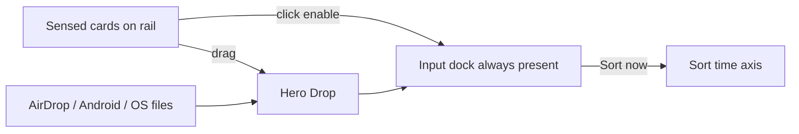

# Input dock + chron Sort (MVP UX)

Locked stays: no Cards & volumes chip strip; Files not Phone; Rec.709 default for Log; no “matches FCP” / ΔE in shipping copy ([MODEL-EVAL.md](design/handoff/wireframes/keep-sort/MODEL-EVAL.md)).

## What is wrong today

[import-wf.html](design/handoff/wireframes/keep-sort/import-wf.html) already paints sensed volumes on the top rail (`renderFunnel`) and Drop asks “Sort this card?”. Two gaps vs the last working grammar:

- **Click does not enable.** Funnel cards only open the Sort confirm. The old `src-box` rule was: single-click Include, double-click off (`box.title = "Click to Include"` around line 2877).
- **There is no input dock.** Enabled volumes live in leftover lanes under Drop, or vanish into a one-volume handoff. Sort then **filters to one source** (`applyHandoff` in [keep-wf.html](design/handoff/wireframes/keep-sort/keep-wf.html) keeps only `card` / `drone` / `phone`). That hides the dump: phone + card + T7 belong on **one time axis**.
- AirDrop / OS drop exist, but `#phone-card` is CSS-hidden and inbound files do not show as a growing input in a dock.

## Import layout (click → dock → keep loading)

**Top rail** — every `catalog` item with `sensed: true` (Sony cards, DJI, T7, phone inbox). Same cards as now.

**Click-to-enable** (previous iteration, on the rail cards):

- Click a grey card → `activate(id)` → card presses on → it **lands in the Input dock**. Preprocess starts (`enqueuePrecompute`). No Sort confirm on first click.
- Click an already-on card → focus that volume in Files.
- Double-click an on card → `deactivate` (off), it leaves the dock; preprocess is held, not wiped (existing `preCache` resume).
- Drag a card onto Drop is the same as click-enable (plus Drop highlight). Do not restore a chip strip under Drop.

**Hero Drop** — OS folders/files, AirDrop, Android Nearby Share / “send to Mac”. Each inbound burst is a dock tile (Inbox / Downloads), count ticks up, preprocess keeps running. Hide the old standalone phone-card chrome; the dock tile **is** the inbox.

**Input dock** (new, always reserved height — same idea as Sort’s Kept dock):

- One tile per enabled volume: name, file count, **Ready n/m** for that volume.
- Inbound tiles pulse while files are still landing.
- Empty state: “Click a card or Drop · AirDrop and Android land here”.
- **Sort now** on the dock (not a modal per card). Handoff is the **set** of docked ids, not one `vol`.

Leave `#lanes` / Add source out of the hero column so Import is rail + Drop + dock + Files. Footer Ready N/M stays the global preprocess line.

## The MVP boom: chron first, pretty later

The product lie to avoid: “wait until Rec.709 / masks / thumbs are done, then Sort.”

Cameras already wrote a clock. A 256 KB head (what native `onDir` / `readOne` already do) gives **name + time + unread tile** immediately. That is enough to put a file on the axis.

Sort is **one chronological contact sheet** of every docked input:

- New AirDrop / Android files **append by their clock**, they do not reset the dump.
- Tiles start as grey `unread` → embedded preview → Rec.709 on Log (default on). Keep / K / dock-keep works on unread tiles.
- Pinch time and the time-rod stay; they only need timestamps.
- Footer / dock: **Ready N/M** = preprocess units finished, not a RAM meter and not a gate. “Sort now” is enabled as soon as **any** file has a time.

Preprocess order already in `PRE_STEPS` (`log`, `raw`, `masks`, `near`, `dust`, `rec709`, `grade`) stays **behind** the axis. Priority for the wireframe: files **near the playhead** first, then Log/Rec.709, then the rest. Do not claim masks / near / dust quality; do not put a ΔE number on the tile.

Clock-shift (phone vs body) is **out of MVP** unless a file has no time — those sit in an “untimed” run at the end, not a Match step.

## Sort page change

In [keep-wf.html](design/handoff/wireframes/keep-sort/keep-wf.html), stop filtering to one `HANDOFF_SRC`. Handoff becomes `{ vols: [...], place }`. Show all matching clips (card + drone + phone) on the existing TI runs. Fold bar: “Sort · N inputs · Ready n/m”. Input dock does not replace the Kept dock — Kept stays the keeper strip; inputs stay a compact source line or the fold-bar chips.

Demo inbound: while Sort is open, a fake AirDrop tick (same as today’s `receiveAirDrop`) inserts 1–3 phone clips onto the axis and bumps Ready. That is the “keep loading, then boom” beat.

## Copy / claims

Safe: “Rec.709 for Log”, “Ready 180/480”, “on the time axis”.  
Not safe: “matches Final Cut”, a single ΔE, “colour-accurate”.

## Files

- [import-wf.html](design/handoff/wireframes/keep-sort/import-wf.html) — click-enable, Input dock, inbound → dock, hide lanes/phone-card, multi-vol handoff.
- [keep-wf.html](design/handoff/wireframes/keep-sort/keep-wf.html) — union axis, Ready on fold bar, inbound append demo.
- [README.md](design/handoff/wireframes/keep-sort/README.md) — lock this grammar (click-enable + input dock; chip strip still gone).

Spot-check on the existing hotserve (`:8788` if `:8787` is still taken).
